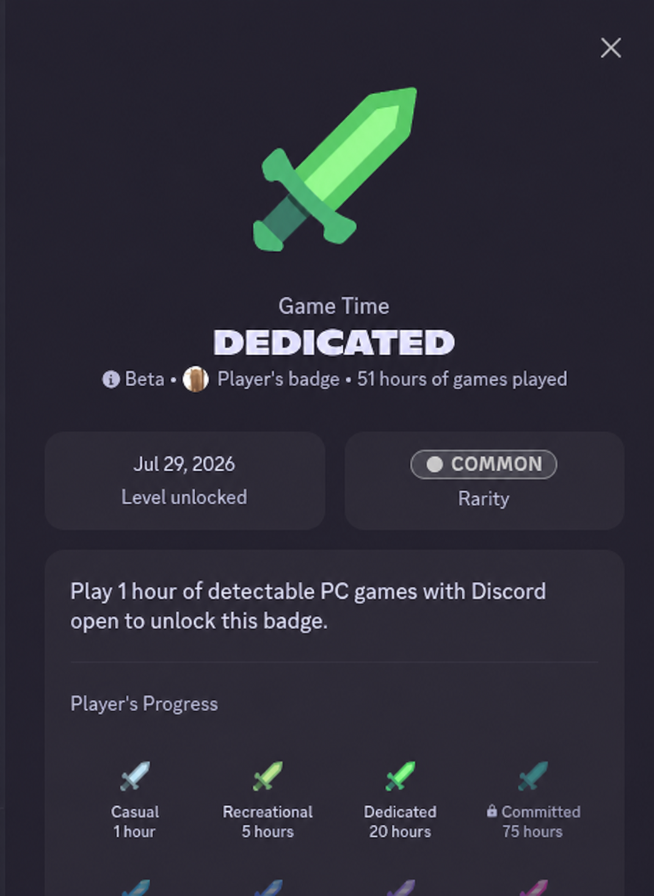
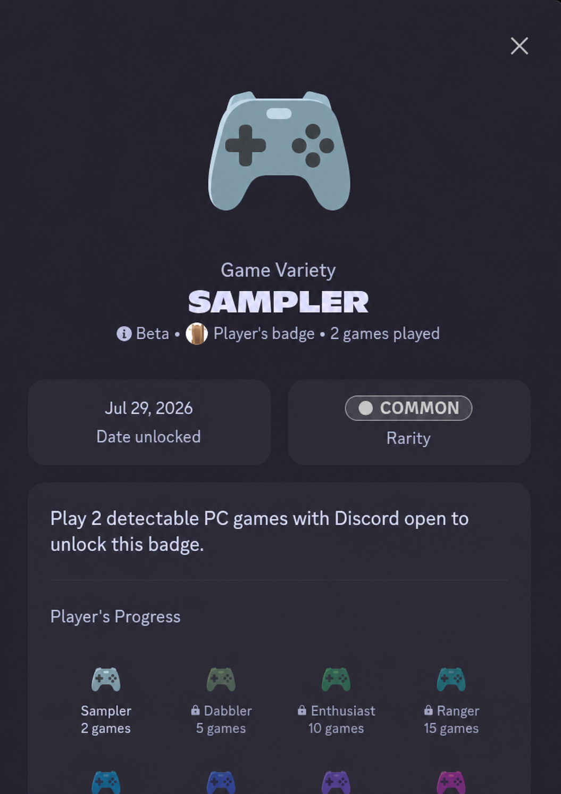

# Discord Game Badge Presence — Game Time & Game Variety

Discord Game Badge tracker and desktop Rich Presence experiment for the beta **Game Time (Dedicated)** and **Game Variety (Sampler)** profile badges. Includes a Counter-Strike 2 presence script and a 125-game rotating presence script for Linux and Windows.

**Related searches:** Discord Game Time badge, Discord Game Variety badge, Discord Dedicated badge, Discord Sampler badge, Discord games played badge, detectable PC games, Discord Rich Presence, Discord game activity, Counter-Strike 2 Discord presence, and Discord Linux game detection.

| Game Time — Dedicated | Game Variety — Sampler |
| --- | --- |
|  |  |

> [!WARNING]
> **ACCOUNT BAN RISK:** These scripts are not an official Discord feature or API. They modify undocumented Discord client internals and generate synthetic game activity. Their use may lead to warnings, badge progress removal, temporary suspension, or permanent account termination. They are not undetectable, approved, or ban-safe. If you are unwilling to accept the possibility of losing your Discord account, do not run them.

By downloading, running, modifying, or distributing this project, you assume all risks associated with your use. The authors and contributors are not responsible for account bans, suspensions, lost data, lost purchases, lost rewards, client instability, or other consequences, to the maximum extent permitted by applicable law. Read the full [Disclaimer and Assumption of Risk](DISCLAIMER.md) before using the scripts.

## What this repository does

Discord's beta game badges measure detectable PC game activity while the desktop client is open. This repository explores that client-side detection path through two dependency-free JavaScript scripts:

| Script | Purpose | Platforms | Schedule |
| --- | --- | --- | --- |
| `cs2-presence.js` | Tests a long-running Counter-Strike 2 activity | Linux, Windows | Refreshes every 5 minutes |
| `multi-game-presence.js` | Rotates through 125 unique game names | Linux, Windows | Random 23–38 minute intervals |

The scripts patch Discord's internal `RunningGameStore` and dispatch local game-activity events. They do not launch games, modify Steam playtime, connect to game servers, or interact with VAC.

Badge availability, thresholds, and progression behavior may differ between accounts and Discord client versions because the badge system is in beta. These scripts cannot guarantee badge eligibility or progression.

## Features

- 125 unique game names in the rotation list
- Randomized 23–38 minute game changes
- Dedicated Counter-Strike 2 presence mode
- Automatic Linux and Windows metadata selection
- Vencord Webpack registry support when available
- Manual next-game control
- Clean shutdown and restoration of patched store methods
- No packages, build process, or external network requests
- No Discord token, password, or session-storage access

## Requirements

- Discord desktop client
- Access to the Discord developer console
- A Discord version that exposes the required internal Webpack modules

Discord updates can rename or restructure internal modules, so either script may stop working after a client update. Flatpak, Snap, Vencord, and other modified Discord packages may expose different module behavior.

## Quick start

1. Open the Discord desktop client.
2. Open its developer console.
3. Open either `cs2-presence.js` or `multi-game-presence.js` from this repository.
4. Copy the complete file contents into the console.
5. Run the script and check the console for its activation message.

Run only one presence script at a time. Both scripts patch the same Discord store methods and can interfere with each other.

## Commands

### Stop Counter-Strike 2 presence

```js
window.__cs2Presence.stop()
```

### Advance to the next game immediately

```js
window.__multiGamePresence.next()
```

Manual advancement does not reset the currently scheduled automatic transition.

### Show the current game

```js
window.__multiGamePresence.current
```

### Show all 125 game names

```js
window.__multiGamePresence.games
```

### Stop the multi-game rotation

```js
window.__multiGamePresence.stop()
```

## How it works

The scripts locate Discord's Webpack module registry, resolve `RunningGameStore` and the Flux dispatcher, and inject one synthetic game record. They then dispatch local game-state and activity events resembling Discord's desktop game-detection flow.

The multi-game script keeps only one synthetic game active at a time. Discord does not display 125 simultaneous Playing activities; it displays one primary activity while the script rotates through the complete list sequentially.

Calling `stop()` clears the active timer, restores the original store methods, removes the synthetic game, and clears its local activity.

## Discord Game Badge FAQ

### Does this unlock the Discord Dedicated or Sampler badge?

Not necessarily. The badges are in beta, availability may be account-specific, and Discord can change detection or progression rules. The scripts reproduce local presence signals but cannot guarantee server-side badge credit.

### Can Discord display 125 games simultaneously?

No. Discord displays one primary Playing activity. The multi-game script rotates through 125 unique names sequentially.

### Does it work on Linux?

The scripts detect Linux through the client user agent and emit Linux-style executable metadata. Flatpak, Snap, Vencord, and Discord updates can affect access to internal modules.

### Does it work on Windows?

Yes, the scripts select Windows-style executable metadata when the client is not running on Linux. Compatibility still depends on the current Discord internal module structure.

### Does it run 24/7?

Only while the Discord desktop client and the script remain running. Closing or reloading Discord clears the in-memory changes. The scripts do not install persistence or restart automatically.

### Is it safe for a Discord account?

No account-safety guarantee is made. This is an unofficial client-internals experiment, and Discord may treat automated or modified client behavior as a policy violation.

### Does it steal Discord tokens or send data elsewhere?

No. The current source does not read authentication tokens, passwords, local storage, or session storage. It does not call external servers, download files, or execute operating-system commands. Always review source code before running it.

### Does it modify Counter-Strike 2, Steam, or VAC?

No. It does not attach to the CS2 process, modify game files, change Steam playtime, or communicate with VAC. It only changes in-memory state inside the Discord client.

## Limitations

- No real game process is launched.
- Steam status, game time, and in-game data are not changed.
- Discord reloads and restarts stop the scripts.
- `application_id` is not supplied, so some Discord versions may not treat the activity as a verified game.
- A real game can conflict with the synthetic activity's display priority.
- Synthetic executable paths are metadata and do not point to launched processes.
- Discord can change internal APIs without notice.
- Badge progression is not guaranteed.

## Troubleshooting

### `Discord webpack registry was not found`

The script may be running in Discord Web, an incompatible desktop build, or an environment where the Webpack registry is unavailable.

### `RunningGameStore/Dispatcher was not found`

Discord may have changed internal module names or structures. The module lookup logic must be adapted to that client release.

### The activity is not visible

- Verify that Discord's setting to display current activity as a status message is enabled.
- Check the developer console for the script's activation or error message.
- Confirm that only one presence script is running.
- Stop the script and restart Discord before retrying.

## Cleanup

Run the relevant `stop()` command first. Restarting Discord clears all remaining in-memory changes. Neither script starts automatically after a restart.

## Privacy

The screenshots displayed in this README use an anonymized placeholder instead of the account username. Avoid publishing raw Discord badge screenshots that expose a username, avatar, account identifier, server name, or other linkable profile information.

## Disclaimer

This repository is an independent technical experiment and is not affiliated with, endorsed by, or sponsored by Discord, Valve, Steam, or Vencord. Discord and all referenced game names are trademarks of their respective owners. The software is provided **"AS IS"** without warranties or guarantees. See [DISCLAIMER.md](DISCLAIMER.md) for the complete account-risk, no-warranty, and limitation-of-responsibility notice.
